# Panduan Lengkap WarungCerdas POS

**Diperbarui: 27 Oktober 2026**  
Panduan ini untuk peran **Kasir** dan **Admin Toko**. Bagian akun Administrator Utama tidak termasuk.

WarungCerdas POS dapat dibuka melalui browser di komputer, tablet, atau ponsel. Nama menu dapat terlihat sedikit berbeda bergantung ukuran layar. Tombol dan proses utamanya tetap sama.

## 1. Perbedaan akses

| Peran | Kegunaan utama |
| --- | --- |
| Kasir | Membuat pesanan, menerima pembayaran, melihat pesanan dan struk. |
| Admin Toko | Semua fungsi kasir, ditambah pengelolaan produk, kategori, topping, promo, laporan, keuangan, profil toko, QRIS, akun pengguna, dan arsip transaksi. |

Menu yang tidak terlihat berarti fitur tersebut tidak tersedia untuk peran akun yang sedang digunakan. Hubungi Admin Toko bila akses kerja Anda perlu diperiksa.

## 2. Masuk dan keluar dari aplikasi

1. Buka alamat web WarungCerdas POS dari browser.
2. Di halaman **Masuk ke akun Anda**, masukkan email akun dan kata sandi, lalu pilih **Masuk**.
3. Jika kata sandi salah, periksa kembali email dan pastikan Caps Lock tidak aktif. Jangan membagikan kata sandi kepada orang lain.
4. Untuk keluar, buka menu akun/navigasi lalu pilih **Keluar**. Biasakan keluar setelah selesai memakai perangkat bersama.

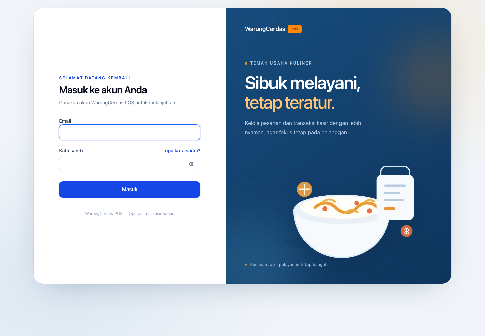

### Lupa kata sandi

1. Pada halaman masuk, pilih **Lupa kata sandi?**.
2. Masukkan email akun yang terdaftar dan kirim permintaan.
3. Jika permintaan berhasil, buka email tersebut dan ikuti tautan reset yang masih berlaku. Periksa folder Spam jika email belum terlihat.
4. Buat kata sandi baru dengan panjang minimal **8 karakter** dan memenuhi petunjuk yang ditampilkan aplikasi, lalu masukkan konfirmasi yang sama.
5. Kembali ke halaman masuk dan gunakan kata sandi baru.

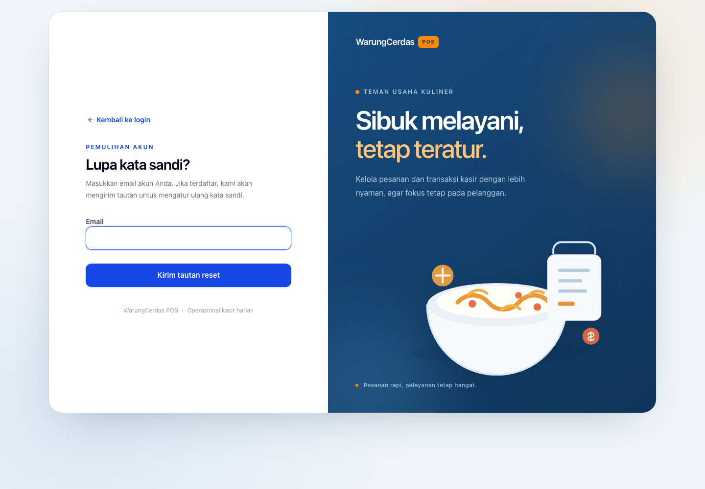
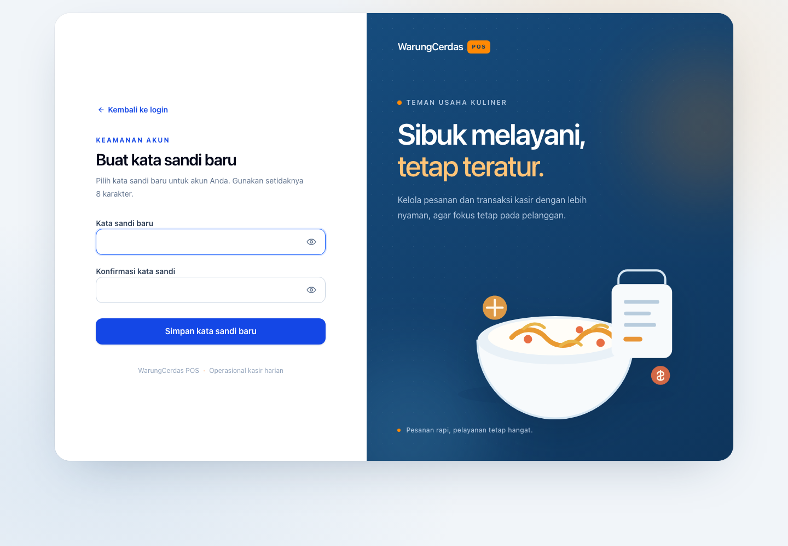

Jika email pemulihan tidak diterima atau alamat email akun tidak dapat diakses, hubungi Admin Toko untuk bantuan. Jangan mengirim kata sandi lama melalui chat.

### Mengganti kata sandi sendiri

1. Setelah masuk, buka menu **Profil/Akun** atau **Ubah Password**.
2. Masukkan kata sandi saat ini.
3. Masukkan kata sandi baru dan konfirmasinya. Gunakan minimal 8 karakter dan jangan memakai kata sandi yang sama dengan akun lain.
4. Pilih **Ubah Password**. Jika sistem meminta masuk kembali, login dengan kata sandi baru.

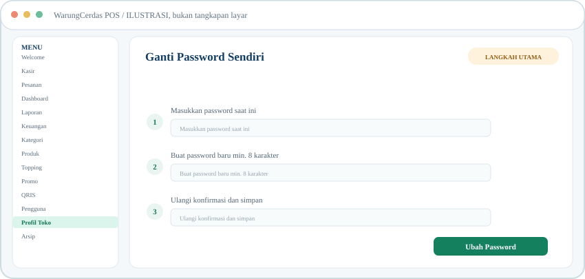

## 3. Halaman Welcome dan status toko

Halaman Welcome adalah halaman awal yang menampilkan identitas toko dan pintasan. Pilih **Mulai Kasir** untuk membuka halaman transaksi atau **Lihat Pesanan** untuk memantau pesanan.

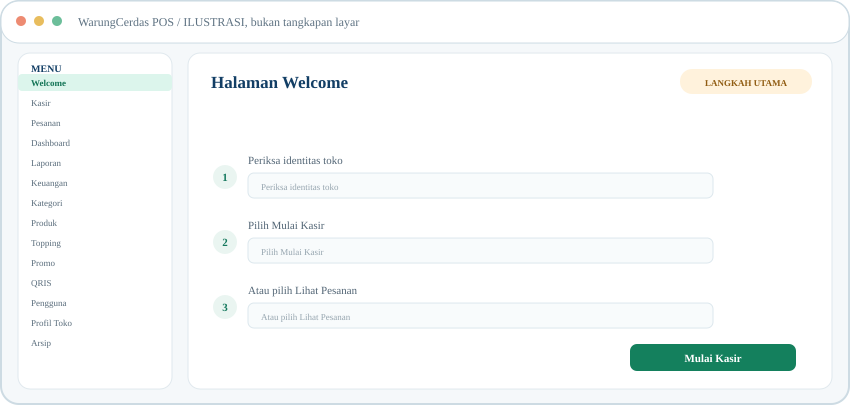

Admin Toko dapat mengatur status toko dari menu **Profil Toko**:

1. Periksa bagian **Status Toko**.
2. Gunakan kontrol status untuk membuka atau menutup toko.
3. Saat toko tutup, kasir melihat pemberitahuan dan transaksi baru tidak dapat diproses. Minta Admin Toko membuka toko sebelum melanjutkan transaksi.

## 4. Membuat transaksi di menu Kasir

### Menambahkan produk

1. Buka menu **Kasir** atau pilih **Mulai Kasir**.
2. Cari nama produk/kategori pada kolom pencarian, atau pilih tombol kategori. Pilih **Semua** untuk melihat semua kategori.
3. Ketuk/klik kartu produk. Produk masuk ke daftar pesanan di sisi kanan atau bagian bawah layar.
4. Sesuaikan jumlah dengan tombol tambah/kurang pada item. Hapus item dari daftar jika pelanggan membatalkannya.
5. Untuk produk yang mendukung topping, pilih topping yang diminta dan periksa tambahan harganya.
6. Pastikan nama produk, jumlah, dan total sementara benar sebelum checkout.

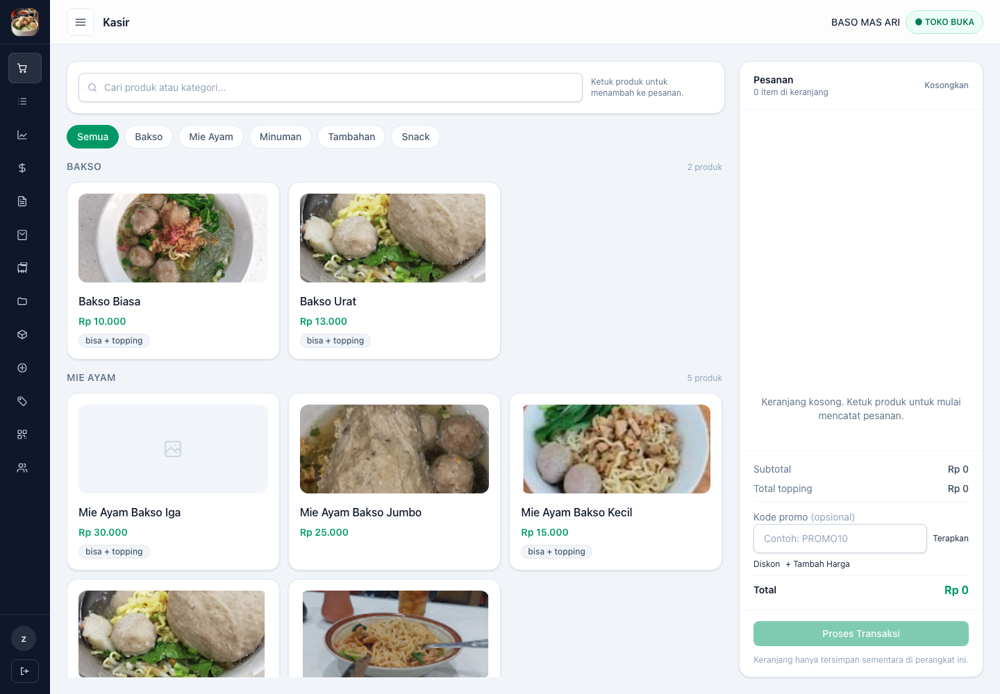

Produk yang tidak tersedia tidak dapat dipilih. Jika produk yang dicari tidak muncul, minta Admin Toko memeriksa status produk dan kategorinya.

### Checkout dan jenis pesanan

1. Pilih tombol checkout/lanjut pada panel pesanan.
2. Pilih tipe pesanan yang sesuai:
   - **Dine In**: isi nomor meja.
   - **Takeaway**: pesanan dibawa pulang.
   - **Delivery**: pilih platform yang tersedia, seperti ShopeeFood, GoFood, atau GrabFood.
3. Nama pelanggan dan catatan bersifat opsional. Catatan dapat berisi instruksi seperti “tanpa sayur” atau tingkat kepedasan.
4. Pilih **Lanjut**. Jika ada informasi wajib yang belum diisi, lengkapi pesan kesalahan yang muncul.
5. Periksa halaman **Preview Total**. Cocokkan item, topping, potongan promo bila tersedia, dan total pembayaran. Pilih **Kembali** untuk memperbaiki pesanan atau **Lanjut ke Pembayaran**.

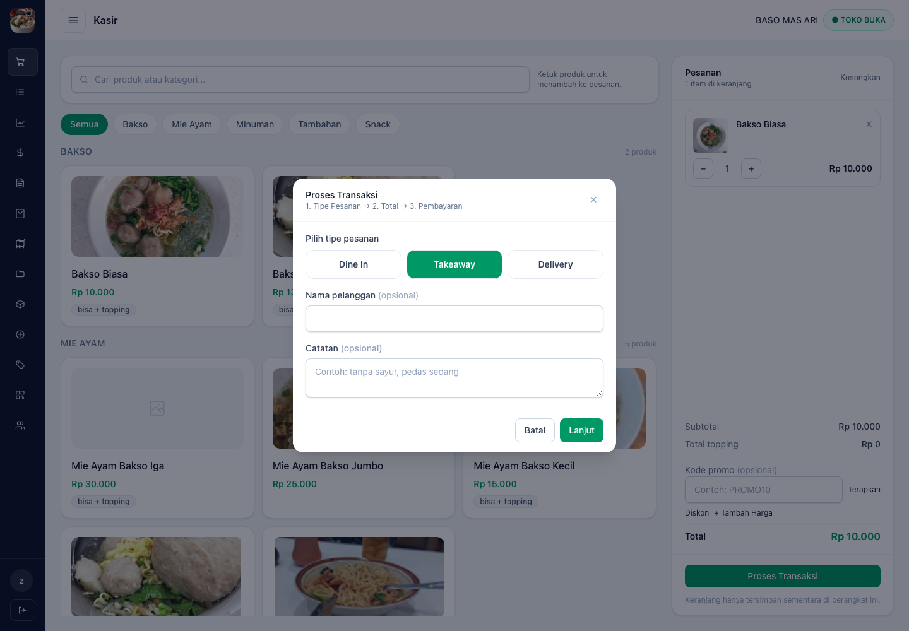
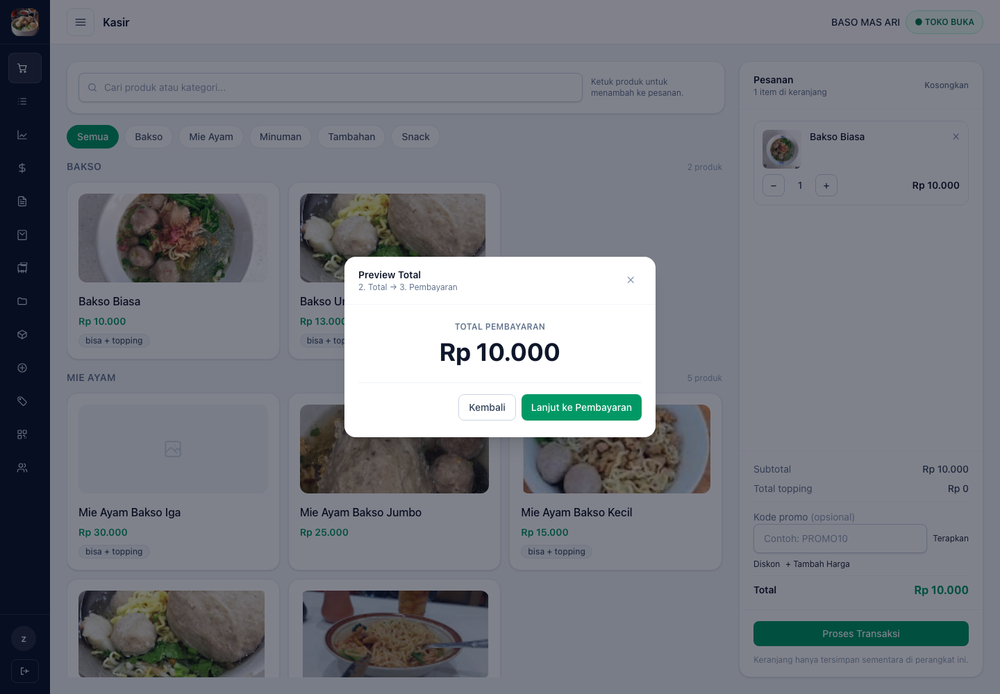

Pada panel pesanan, kode promo dapat dimasukkan sebelum transaksi diproses. Ketik kode lalu pilih **Terapkan**; pastikan pesan berhasil dan nilai potongan muncul. Tombol **Diskon** digunakan untuk memasukkan potongan nominal atau persentase sesuai kebijakan toko. **+ Tambah Harga** digunakan untuk biaya tambahan yang memang disepakati. Selalu cek ulang total setelah perubahan ini.

### Menerima pembayaran

1. Pilih metode **Tunai** atau **QRIS**.
2. Untuk Tunai, masukkan nominal uang yang diterima. Pastikan nominal mencukupi; aplikasi menampilkan kembalian.
3. Untuk QRIS, tampilkan gambar QRIS/petunjuk kepada pelanggan dan pastikan pembayaran benar-benar diterima melalui aplikasi merchant atau rekening usaha. Gambar QRIS di POS hanya petunjuk; aplikasi tidak mengonfirmasi transfer secara otomatis.
4. Periksa kembali jumlah yang dibayar, lalu konfirmasi/simpan transaksi.
5. Setelah transaksi berhasil, gunakan **Struk** atau buka pesanan untuk melihat dan mencetak struk jika diperlukan.

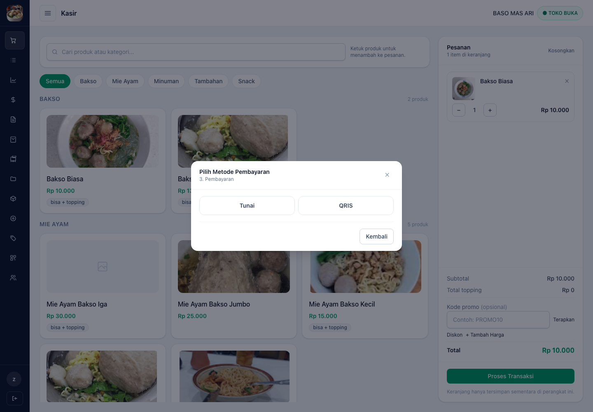
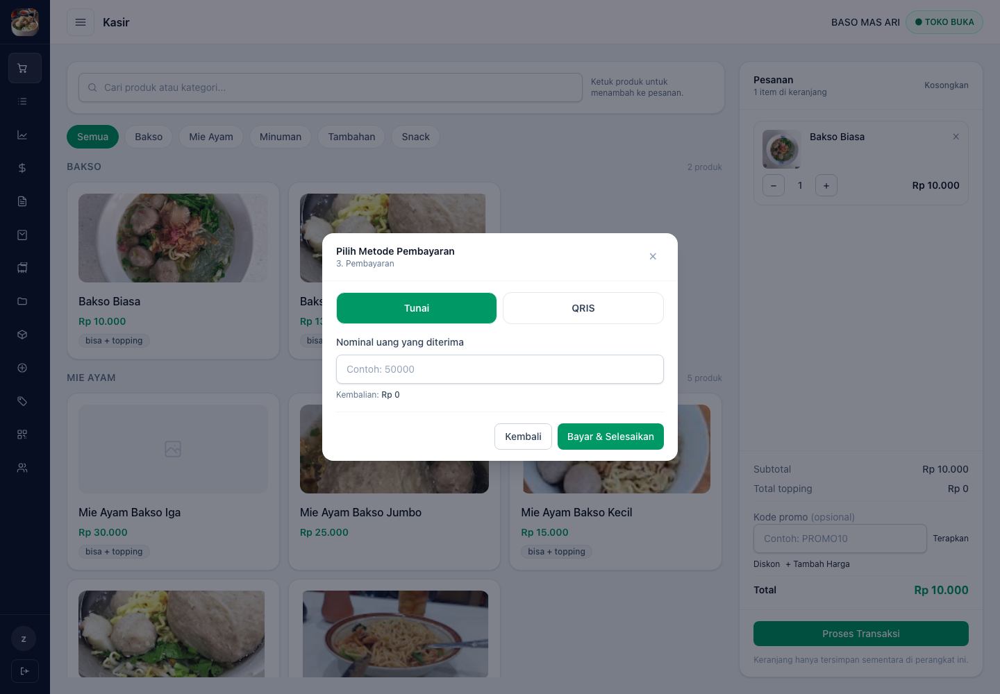

Jangan menandai pembayaran QRIS berhasil hanya berdasarkan tangkapan layar pelanggan. Cocokkan dengan notifikasi atau mutasi pada kanal pembayaran usaha.

## 5. Memantau pesanan dan struk

1. Buka menu **Pesanan**.
2. Gunakan filter status: **Aktif**, **Semua**, **Baru**, **Diproses**, **Siap**, **Selesai**, atau **Dibatalkan**.
3. Gunakan filter tipe untuk melihat semua pesanan, **Bungkus**, **Dine-in**, atau **Delivery**.
4. Pilih **Detail** untuk memeriksa item, jumlah, harga, total, pembayaran, metode, kembalian, waktu bayar, dan catatan.
5. Pilih **Struk** atau **Lihat Struk** untuk mencetak/melihat bukti transaksi.
6. Untuk transaksi baru, gunakan **+ Pesanan Baru**.

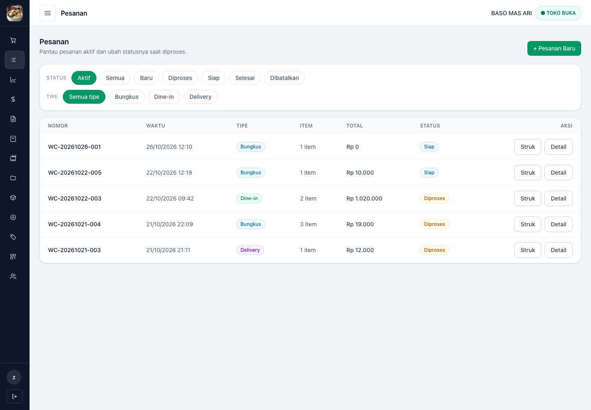
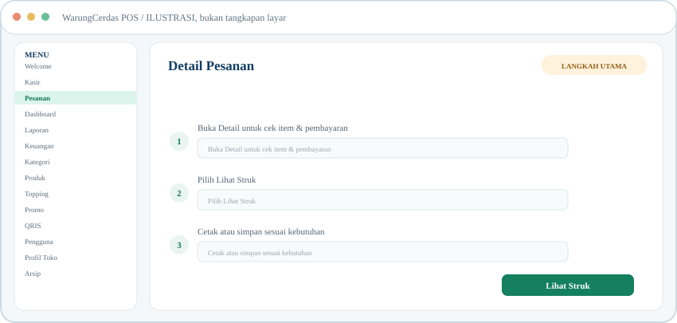

Status pesanan menunjukkan kemajuan penyiapan. Periksa detail transaksi sebelum menyerahkan pesanan, terutama tipe pesanan, meja/platform, catatan, dan status pembayaran.

## 6. Menyiapkan katalog (Admin Toko)

### Kategori

1. Buka **Kategori** lalu pilih **+ Tambah Kategori**.
2. Isi nama kategori dan urutan tampil. Centang status aktif agar kategori dapat digunakan.
3. Pilih **Simpan**. Gunakan **Ubah** untuk memperbaiki nama/urutan atau status.
4. Nonaktifkan kategori yang sedang tidak dipakai. Pastikan kategori aktif tersedia sebelum produk dimasukkan ke kasir.

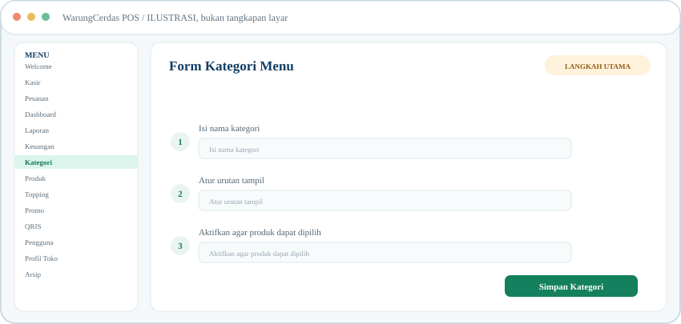

### Topping

1. Buka **Topping** lalu pilih **+ Tambah Topping**.
2. Isi nama dan harga tambahan. HPP bersifat opsional; gambar juga opsional (format JPG, PNG, WebP, maksimal 2 MB).
3. Atur apakah topping tersedia, kemudian pilih **Simpan**.
4. Buka formulir produk terkait untuk menentukan topping mana yang boleh ditambahkan pada produk tersebut.

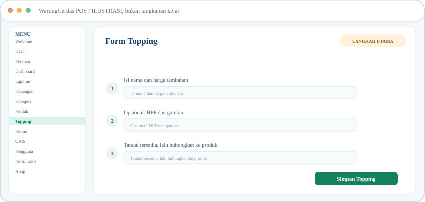

### Produk

1. Buka **Produk** lalu pilih **+ Tambah Produk**.
2. Pilih kategori, isi nama produk, dan harga jual (angka tanpa titik, misalnya `15000`).
3. Isi HPP bila diketahui. HPP membantu perhitungan analisis laba dan bukan harga yang dibayar pelanggan.
4. Unggah gambar bila perlu (JPG, PNG, WebP, maksimal 2 MB).
5. Centang **Produk tersedia dan bisa dipesan** agar produk tampil di kasir.
6. Pilih topping yang diizinkan untuk produk ini.
7. Pilih **Simpan**. Untuk perubahan berikutnya, pilih **Ubah** di daftar produk.

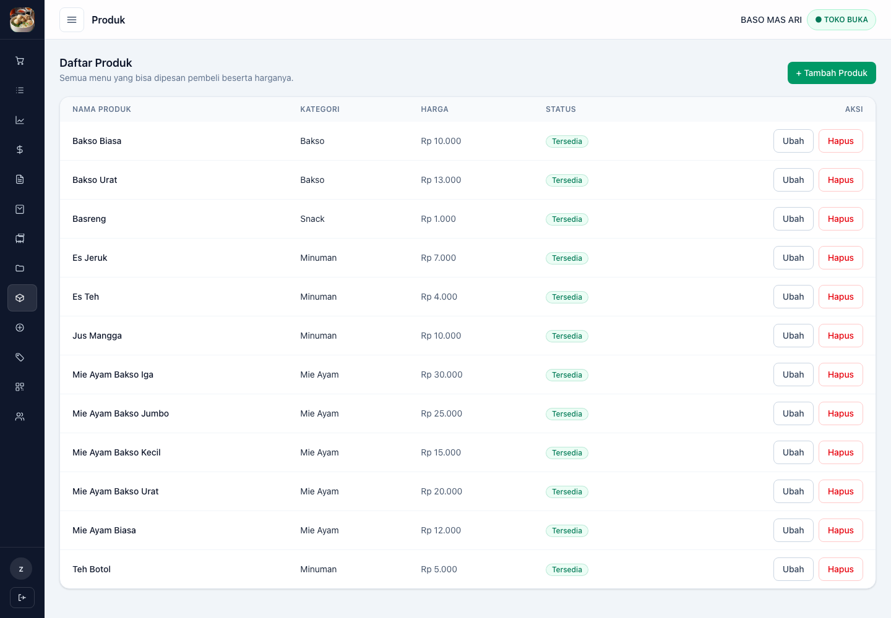
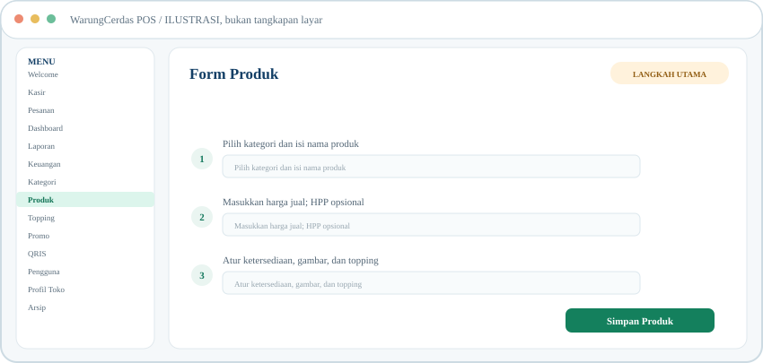

Sebelum membuka kasir, pastikan produk berada di kategori yang aktif, status tersedia aktif, serta harga dan toppingnya benar.

## 7. Mengelola promo (Admin Toko)

1. Buka **Promo** dan pilih **+ Tambah Promo**.
2. Isi kode unik dan nama promo.
3. Pilih jenis potongan persentase atau nominal rupiah dan isi nilainya. Untuk persentase, batasnya 0,01–100. Isi minimal belanja bila berlaku dan batas maksimal potongan bila diperlukan.
4. Pilih cakupan promo: semua item, produk tertentu, atau kategori tertentu. Lengkapi pilihan produk/kategori jika diminta.
5. Atur tanggal/jam mulai dan berakhir, batas pemakaian yang tersedia, serta status aktif pada form.
6. Simpan. Periksa daftar promo dan pastikan kode, masa berlaku, nilai, dan cakupan sesuai kebijakan toko.
7. Kasir mengetik kode pada kolom **Kode promo** di panel pesanan dan memilih **Terapkan**. Pastikan diskon tampil pada total sebelum pembayaran.
8. Untuk mengakhiri atau memperbaiki promo, gunakan **Ubah** atau nonaktifkan/hapus dari daftar sesuai kebutuhan.

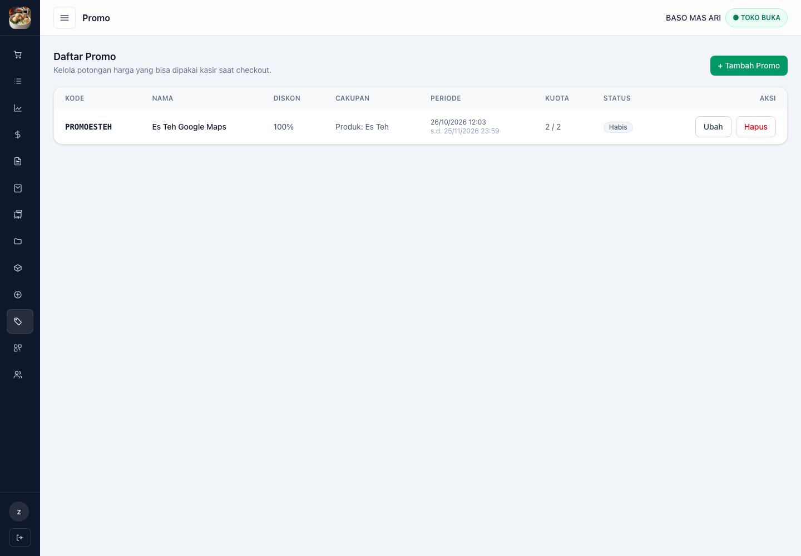
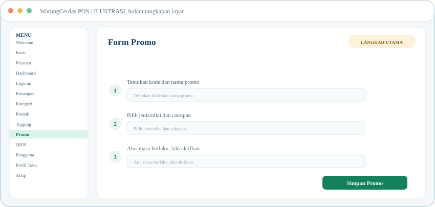

## 8. Profil toko dan QRIS (Admin Toko)

### Profil Toko

1. Buka **Profil Toko**.
2. Perbarui **Nama Toko**, **Nama POS**, judul halaman Welcome, dan subjudul sesuai identitas usaha.
3. Unggah logo toko bila diperlukan (JPG, PNG, WebP, maksimal 2 MB). Periksa pratinjau sebelum menyimpan.
4. Pilih **Simpan Perubahan**. Nama dan logo dapat muncul pada tampilan aplikasi atau struk.
5. Atur **Status Toko** pada halaman ini sesuai jam operasional.

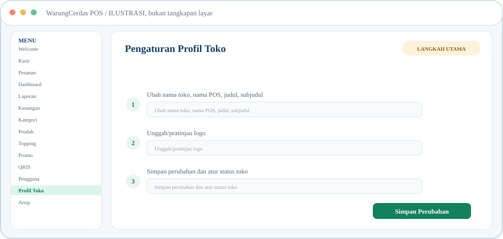

### Gambar QRIS

1. Dari Profil Toko, pilih **QRIS**.
2. Periksa gambar saat ini. Unggah file QRIS yang benar (JPG, PNG, WebP, maksimal 2 MB), lalu pilih **Unggah dan Simpan**.
3. Pastikan gambar yang tampil jelas dan milik rekening usaha yang benar. Lakukan pembayaran uji dengan nominal kecil melalui prosedur internal usaha jika diperlukan.
4. Ingat: POS hanya menampilkan gambar sebagai panduan pembayaran, bukan memvalidasi pembayaran otomatis.

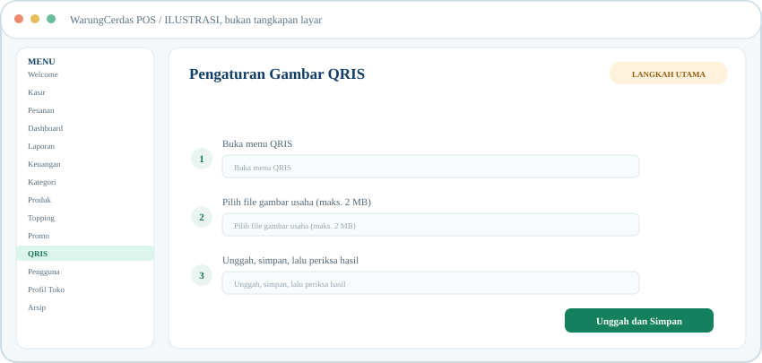

## 9. Akun pengguna biasa (Admin Toko)

1. Buka **Pengguna** atau **Manajemen Akun**, lalu pilih **+ Tambah Akun**.
2. Isi nama lengkap, email unik, peran yang memang diperlukan (**Admin Toko** atau **Kasir**), serta kata sandi awal dan konfirmasinya.
3. Kata sandi minimal 8 karakter. Berikan kata sandi awal secara langsung kepada pemilik akun melalui kanal pribadi yang aman dan minta mereka menggantinya setelah login.
4. Pilih status aktif sesuai kebutuhan, lalu **Simpan**.
5. Untuk memperbaiki nama/email/peran atau mengganti kata sandi akun biasa, pilih **Ubah** pada akun tersebut. Admin Toko dapat menetapkan kata sandi baru; kata sandi lama tidak ditampilkan.
6. Untuk menghentikan akses sementara, nonaktifkan akun dari daftar pengguna. Hapus akun hanya jika memang perlu dan pastikan kepemilikan datanya sudah diperiksa.

Berikan peran Admin Toko hanya kepada orang yang memang perlu mengelola data dan pengaturan. Gunakan peran Kasir untuk pekerjaan transaksi sehari-hari.

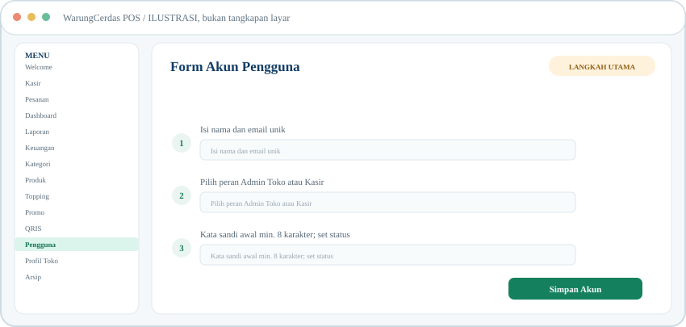

## 10. Dashboard, laporan penjualan, dan ekspor (Admin Toko)

### Dashboard

Buka **Dashboard** untuk melihat ringkasan operasional yang disediakan, misalnya transaksi dan penjualan. Gunakan sebagai ringkasan cepat; buka laporan untuk pemeriksaan periode dan rincian.

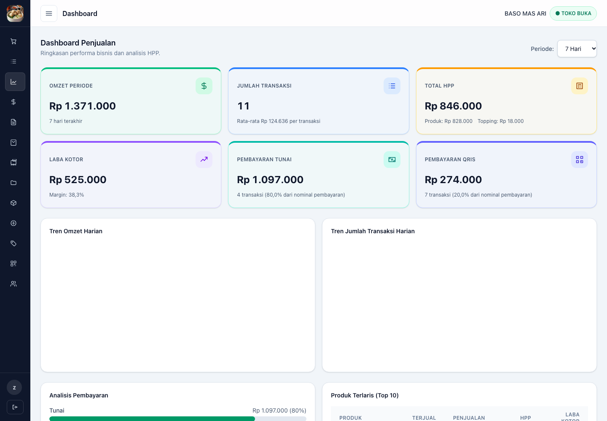

### Laporan

1. Buka **Laporan** atau **Laporan Penjualan**.
2. Pilih periode yang tersedia. Untuk rentang khusus, isi tanggal mulai dan akhir lalu pilih **Terapkan**.
3. Tinjau ringkasan penjualan, produk/topping terjual, metode pembayaran, jenis pesanan, dan riwayat transaksi.
4. Pada riwayat, cari nomor transaksi atau filter metode pembayaran. Gunakan **Reset** untuk menghapus filter pencarian.
5. Pilih ekspor yang tersedia untuk mengunduh laporan, termasuk PDF/lembar data bila ditampilkan.

Pastikan rentang tanggal sudah benar sebelum ekspor. Angka laporan hanya mencerminkan data yang tersimpan dan filter aktif.

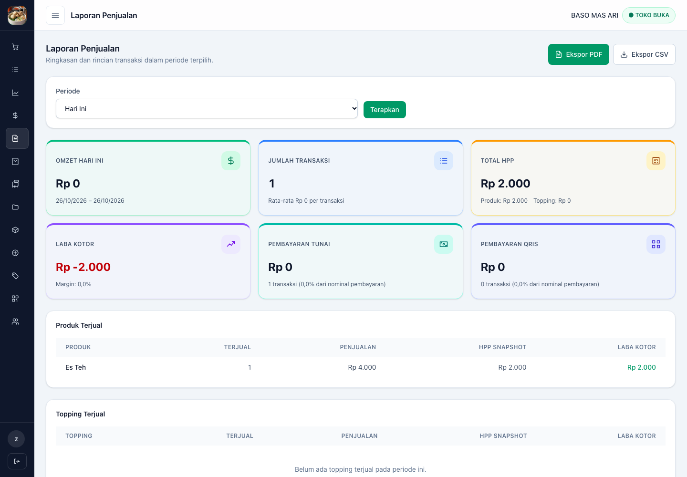
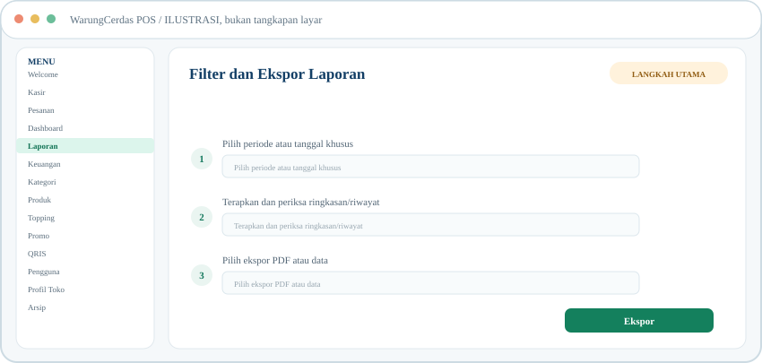

## 11. Keuangan (Admin Toko)

1. Buka **Keuangan** dan pilih periode atau rentang tanggal, kemudian klik **Terapkan**.
2. Tinjau ringkasan pemasukan, pengeluaran, arus kas, margin laba, dan tren harian yang ditampilkan.
3. Untuk mencatat biaya, buka **Kelola Pengeluaran**, pilih tambah, isi tanggal, kategori, nominal, dan keterangan yang diminta, lalu simpan.
4. Untuk mencatat pemasukan di luar transaksi POS, buka **Kelola Pemasukan Lain**, pilih tambah, isi informasi dan nominal, lalu simpan.
5. Kelola kategori keuangan agar pemasukan/pengeluaran dikelompokkan konsisten.
6. Koreksi catatan melalui **Ubah** pada daftar terkait. Cocokkan laporan setelah perubahan.

Untuk pengeluaran, lengkapi tanggal, nominal, kategori, metode pembayaran, keterangan, dan bukti bila tersedia. Bukti menerima gambar JPG/PNG atau PDF. Untuk pemasukan lain, pilih kategori yang tersedia (Modal/Lainnya), metode pembayaran, dan keterangan. Gunakan filter periode untuk memeriksa catatan yang sudah tersimpan.

Masukkan transaksi usaha secara konsisten dan simpan bukti pendukung sesuai prosedur pembukuan toko. Jangan mencatat satu pemasukan dua kali sebagai penjualan POS sekaligus pemasukan lain.

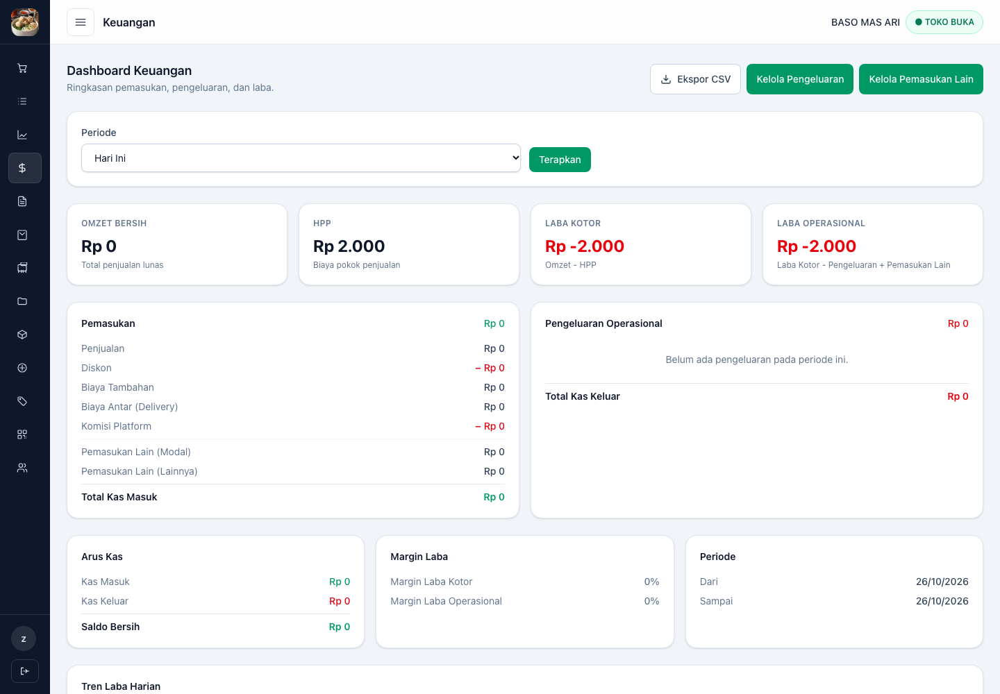
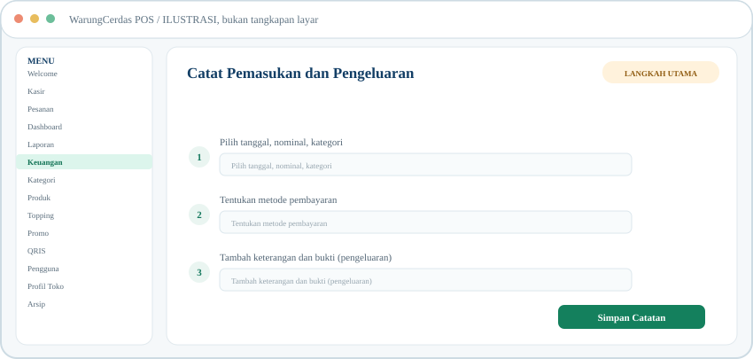

Kategori pengeluaran dapat ditambahkan dan diubah dari menu kategori pada bagian Keuangan. Gunakan nama yang mudah dipahami dan konsisten, lalu pilih kategori tersebut saat mencatat biaya.

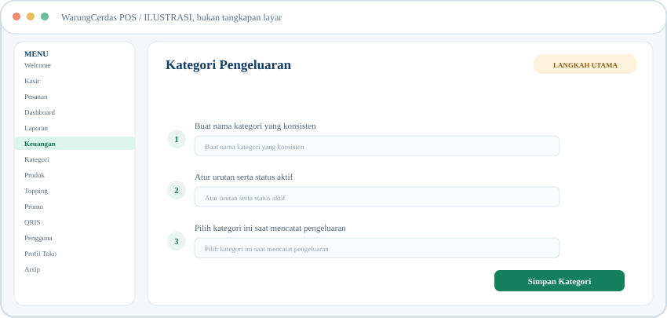

## 12. Arsip transaksi (Admin Toko)

Arsip membantu menyimpan salinan transaksi untuk rentang tertentu. Periksa filter dan pratinjau dengan teliti sebelum membuat arsip.

1. Buka **Arsip Transaksi** lalu pilih tindakan membuat arsip.
2. Tentukan tanggal mulai dan tanggal akhir, filter status, serta format yang tersedia.
3. Pilih **Pratinjau & Buat**. Periksa ringkasan dan contoh transaksi pada halaman pratinjau.
4. Jika rentang dan jumlah data sudah benar, konfirmasi pembuatan arsip. Jika tidak, kembali dan koreksi filter.
5. Unduh arsip dari daftar riwayat ketika dibutuhkan.
6. Menghapus riwayat arsip juga menghapus file arsipnya. Pastikan file masih diperlukan atau sudah disimpan dengan aman sebelum menghapus.

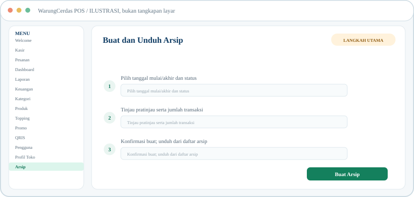

## 13. Alur kerja yang disarankan

### Sebelum toko buka

- Admin Toko memastikan status toko buka.
- Pastikan kategori, produk, harga, ketersediaan, topping, dan QRIS sudah benar.
- Kasir masuk menggunakan akun sendiri dan memastikan koneksi serta printer struk siap.

### Saat melayani pelanggan

- Pilih produk dan jumlah sesuai pesanan.
- Catat tipe pesanan, nomor meja atau platform delivery, dan instruksi khusus.
- Periksa preview total dan potongan sebelum meminta pembayaran.
- Pastikan pembayaran diterima, lalu serahkan pesanan dan struk sesuai kebutuhan.

### Setelah toko tutup

- Selesaikan atau periksa pesanan yang masih aktif.
- Admin Toko periksa laporan dan catat pemasukan/pengeluaran yang diperlukan.
- Tutup status toko bila tidak menerima transaksi lagi.
- Keluar dari akun pada perangkat bersama.

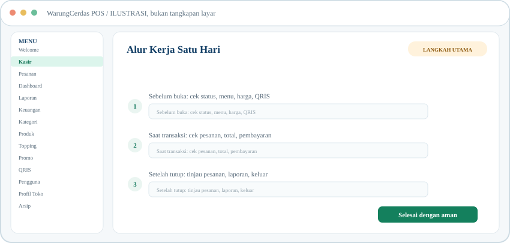

## 14. Pemecahan masalah umum

| Masalah | Yang dapat dilakukan |
| --- | --- |
| Tidak bisa masuk | Pastikan email benar, periksa Caps Lock, lalu gunakan **Lupa kata sandi?** jika perlu. Hubungi Admin Toko jika email akun tidak bisa diakses. |
| Menu tidak terlihat | Periksa peran akun. Admin Toko mengelola akses menu untuk pekerjaan yang sesuai. |
| Toko tutup dan checkout tidak bisa | Minta Admin Toko mengubah status toko menjadi buka. |
| Produk tidak muncul di kasir | Minta Admin Toko memastikan kategori aktif dan produk tersedia. |
| Topping tidak muncul | Pastikan topping tersedia dan sudah dipilih pada pengaturan produk tersebut. |
| Gambar QRIS belum ada/tidak jelas | Admin Toko unggah ulang gambar yang benar pada menu QRIS. Verifikasi nama rekening sebelum digunakan. |
| Promo tidak dapat digunakan | Periksa status aktif, tanggal berlaku, syarat/batas penggunaan, dan nilai pada formulir promo. |
| Laporan tampak kosong | Periksa periode tanggal dan filter yang dipilih; reset pencarian bila perlu. |
| Unggah gambar gagal | Gunakan JPG, PNG, atau WebP dengan ukuran maksimal 2 MB. |
| Halaman bermasalah | Muat ulang halaman. Jika masalah berlanjut, catat waktu, menu, dan pesan kesalahan lalu hubungi bantuan. Jangan mengirim kata sandi atau kode rahasia. |

## Bantuan

Jika memerlukan bantuan penggunaan, hubungi **Zaidan 085158512007**. Sertakan nama menu dan penjelasan masalah; jangan kirim kata sandi, tautan reset, atau informasi pembayaran rahasia.

